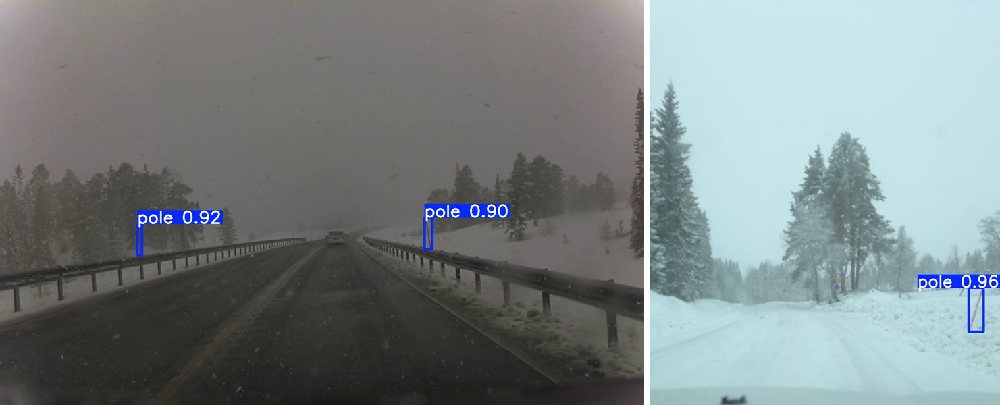
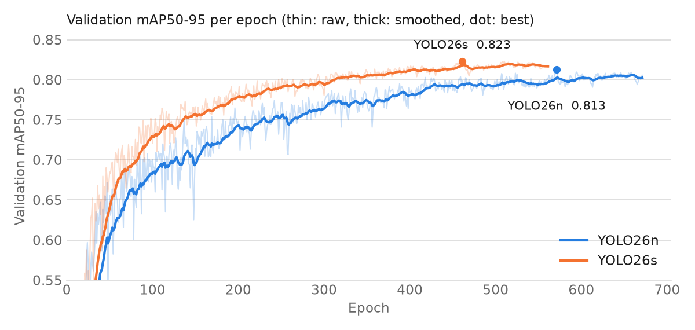
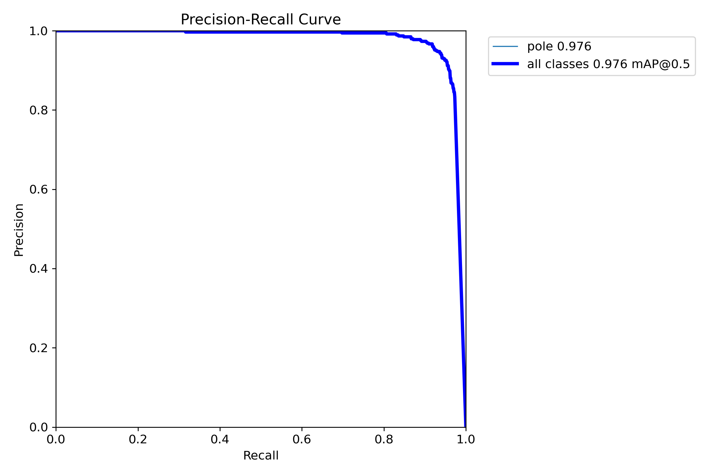
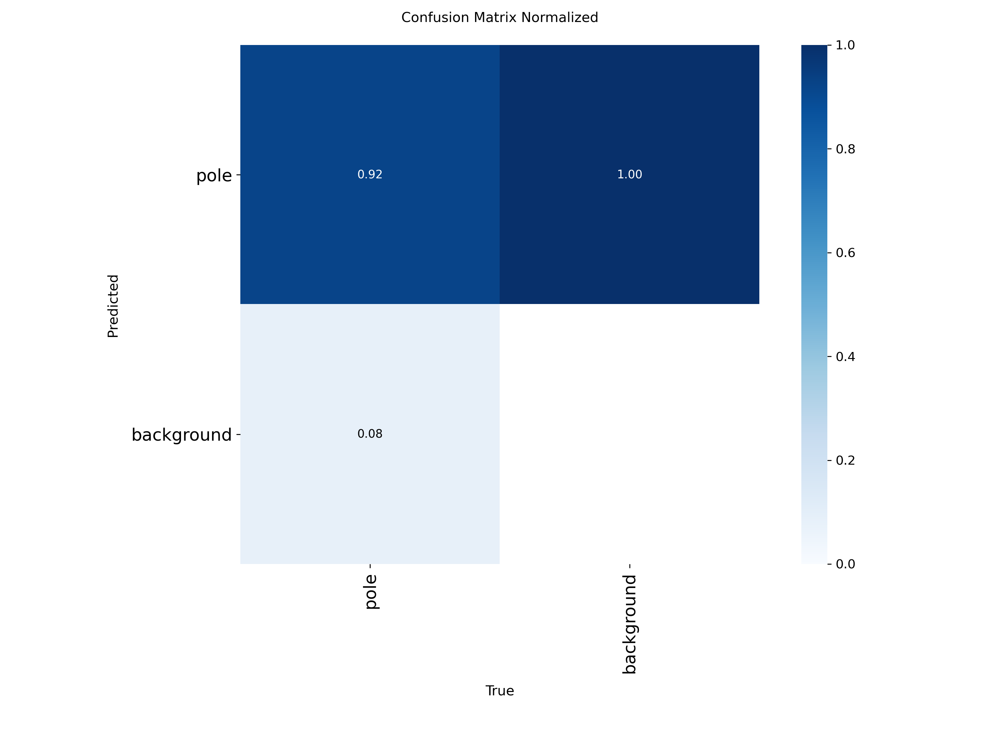
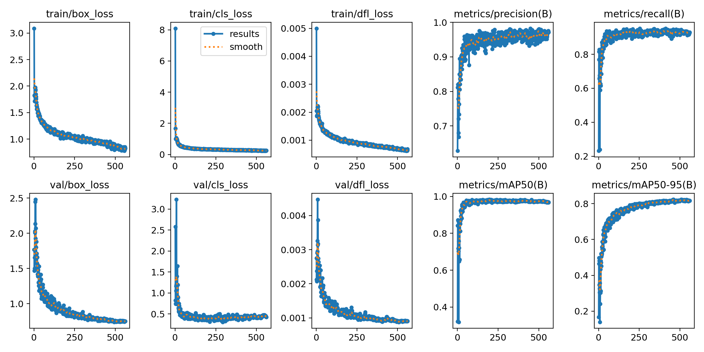
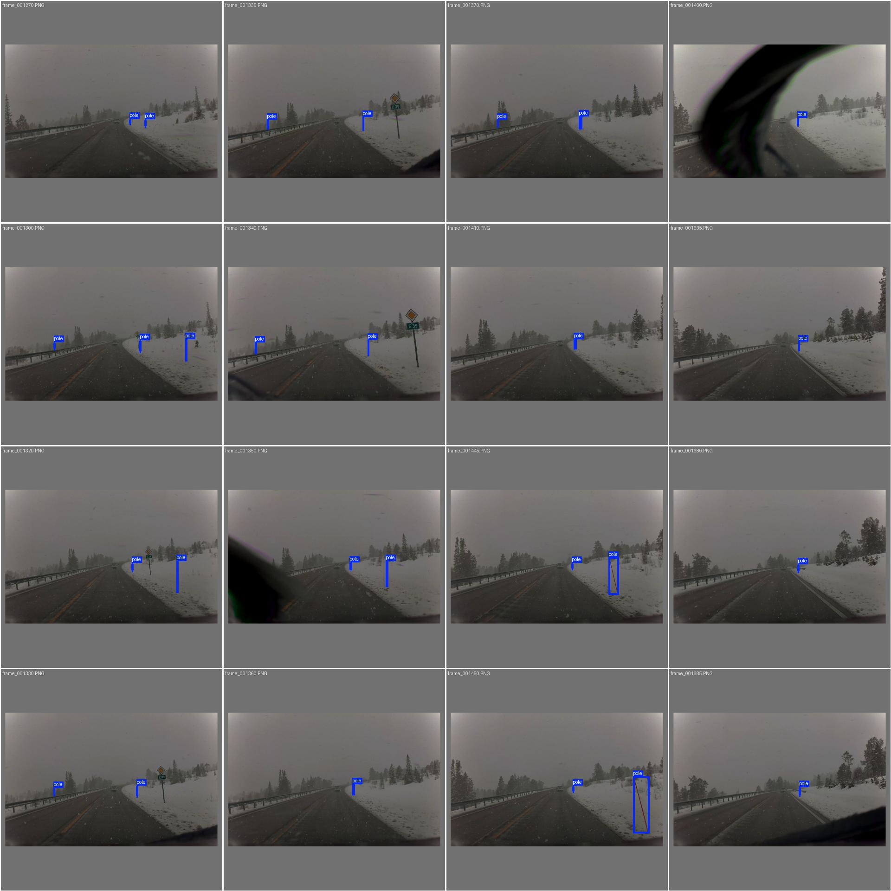
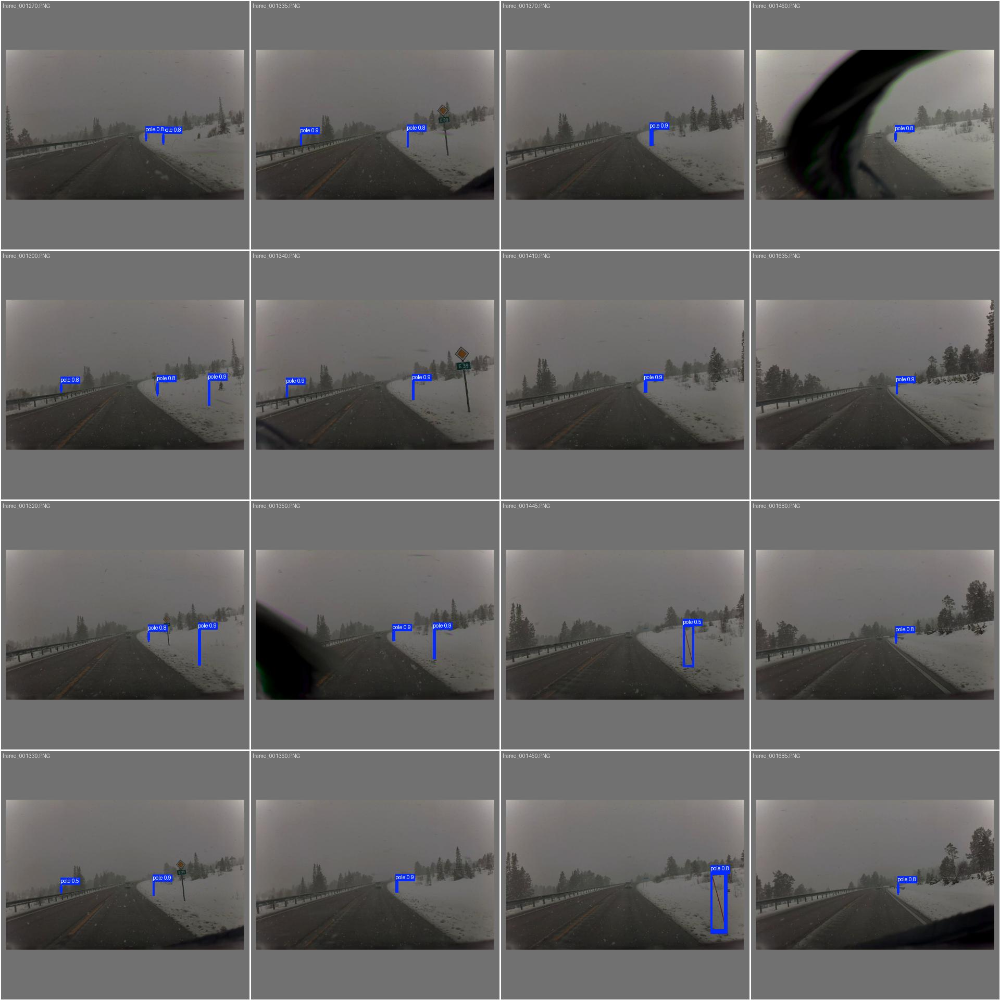
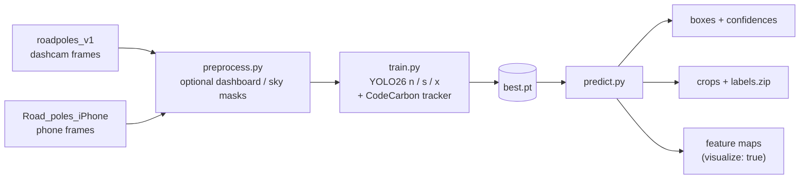
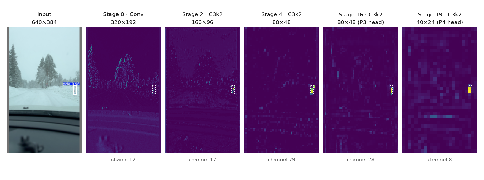
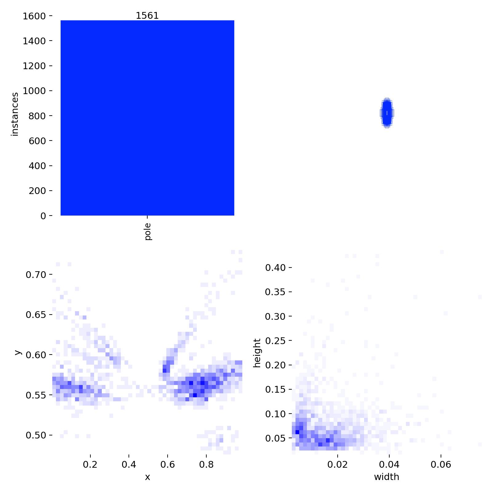

# Snow Pole Detection for Autonomous Driving

Real-time detection of roadside snow poles in Norwegian winter driving, so an autonomous vehicle can find the road when the lane markings are buried.


-lightgrey)

### Demo

<p align="center">
  
</p>
<p align="center"><sub>YOLO26n predictions on held-out frames. Left: dashcam in heavy snowfall (<code>roadpoles_v1</code>). Right: phone camera behind the windshield (<code>Road_poles_iPhone</code>).</sub></p>

### Problem statement

There has been major advancements in Autonomous driving in recent years, attributed to computer
vision and Deep Learning (CV & DL). However, such models are mostly focused on driving in ideal
conditions, and thus struggle with challenging conditions like snowy roads. One way to localize the
road in winter time is by relying on the location of snow poles, which are typically erected on either side
of the road in areas prone to snow in the winter. The task here is to perform real time object detection
of snow poles, in order to further develop AD capabilities in winter conditions.

### Results

Both models were trained on the joint dataset (`dataset/Poles2025/data_joint_2sets.yaml`) at 640 px on one RTX 4090. Metrics are on the validation split at the best epoch. Energy and CO₂eq were measured with CodeCarbon.

| Model | Epochs run | Best epoch | Precision | Recall | mAP50 | mAP50-95 | Train time | Energy | CO₂eq |
|---|---:|---:|---:|---:|---:|---:|---:|---:|---:|
| YOLO26n | 671 | 571 | 0.954 | **0.944** | **0.983** | 0.813 | **45 min** | **0.22 kWh** | **6.6 g** |
| YOLO26s | 561 | 461 | **0.963** | 0.919 | 0.976 | **0.823** | 67 min | 0.32 kWh | 9.7 g |

<picture>
  <source media="(prefers-color-scheme: dark)" srcset="docs/assets/nano_vs_small_dark.png">
  
</picture>

The small model reaches higher box precision (mAP50-95) and gets there in fewer epochs. The nano model has better recall and mAP50, and trains faster with about two thirds of the energy.

#### More training curves (YOLO26s)

<table>
  <tr>
    <td width="50%"></td>
    <td width="50%"></td>
  </tr>
  <tr>
    <td colspan="2"></td>
  </tr>
</table>

#### Validation batch: ground truth vs. prediction

<table>
  <tr>
    <th>Ground truth</th>
    <th>YOLO26s prediction</th>
  </tr>
  <tr>
    <td></td>
    <td></td>
  </tr>
</table>

### Pipeline



Each step is driven by a YAML config in `configs/train/` or `configs/predict/`. Prediction configs ending in `_mask` mask the car dashboard and the sky with polygons before inference.

### Inside the network

With `visualize: true`, `predict.py` saves the activations of every YOLO stage. For each stage below, the channel that responds most strongly inside the detected pole box is shown (dashed outline).

<picture>
  <source media="(prefers-color-scheme: dark)" srcset="docs/assets/feature_maps_dark.png">
  
</picture>

Early layers pick up edges everywhere: tree outlines, the road, the windshield. By the detection-head inputs (stages 16 and 19), the strongest channel fires almost only on the pole.

### Dataset

Data captured in Norway, Trøndelag region.

Two sources are combined: `roadpoles_v1` (dashcam, 1920×1208) and `Road_poles_iPhone` (phone, 1080×1920 portrait). There is one class, `pole`.

#### Label distribution

<p align="center"></p>

Poles are thin, tall boxes clustered near the horizon on both sides of the road.

### Repository layout

```
configs/
  train/            training configs (model, data, epochs, batch)
  predict/          prediction configs (checkpoint, source, masks, visualize)
dataset/Poles2025/  data YAMLs and split lists (images not included)
saved_runs/detect/  trained weights, curves and example predictions
docs/               README images and the script that builds them
train.py            training runner with CodeCarbon emission tracking
predict.py          prediction runner, zips label txt files
preprocess.py       dashboard / sky masking
split_dataset.py    random train / val split of unlabeled images (YOLO layout)
eda*.ipynb          exploratory analysis, label stats, embeddings
embedding_visualization.py, anomaly_detection.py   embedding-based data analysis
```

### Reproduce

1. Create the conda environment:

```bash
conda env create -f environment.yml
conda activate snowpole-detection
```

2. Make sure your dataset is available under `dataset/Poles2025/...` and that paths in the selected config files are valid for your machine.

3. Train a model (example):

```bash
python train.py -c configs/train/001.yaml
```

4. Run prediction with a trained checkpoint (example):

```bash
python predict.py -c configs/predict/roadpoles_v1_013.yaml
```

To also save per-stage feature maps, use a config with `visualize: true`, such as `configs/predict/Road_poles_iPhone_005_visualize.yaml`.

5. Check outputs:

- Training runs are saved in `runs/detect/train*/`
- Prediction outputs are saved in `runs/detect/predict*/`
- Label txt files are zipped to `runs/detect/predict*/labels.zip`

6. Rebuild the README images (needs Pillow and matplotlib):

```bash
python docs/make_readme_assets.py
```
